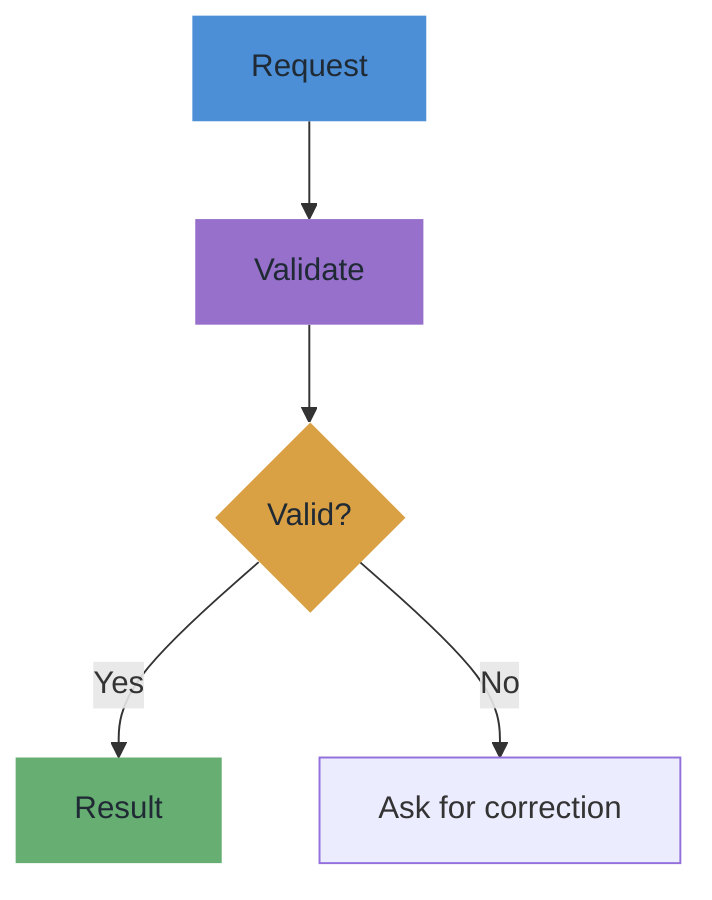

---
cssclasses:
  - wd-visual-v14
---

# Sample project note

> **TL;DR:** A compact example showing section links, grouped cards, a table, and a Mermaid workflow.

## Quick navigation

| Topic | Jump |
|---|---|
| Overview | [[#01｜Overview|01]] |
| Component responsibilities | [[#02｜Components|02]] |
| Workflow | [[#03｜Workflow|03]] |

## 01｜Overview

A fictional example, not a description of any private project.

## 02｜Components

> [!wd-group] Core components
> **Input** — Capture a user request.
>
> ---
>
> **Processing** — Check constraints and choose the next action.
>
> ---
>
> **Output** — Deliver a reviewable result.

| Component | Responsibility |
|---|---|
| Input | Collect context |
| Processing | Validate and plan |
| Output | Present result |

## 03｜Workflow

This diagram highlights the decision branch without changing the workflow meaning.
